  

# 🚀 Awesome Cross-Platform Native App Development

**A curated index of top-tier SaaS platforms, hosted cloud builders, native runtimes, frameworks, and open-source tools for building native iOS, Android, macOS, Windows, and Linux apps from a single unified codebase.**

*Master the cross-platform native software stack: Flutter, React Native, Tauri, Expo, Kotlin Multiplatform (KMP), .NET MAUI, Electron, Wails, Over-the-Air (OTA) pipelines, and Mobile DevOps.*

---

## 📖 Table of Contents

- [📊 Sector Overview & Market Dynamics](#-sector-overview--market-dynamics)
- [☁️ SaaS & Hosted Cloud Platforms](#️-saas--hosted-cloud-platforms)
- [🛠️ Open-Source GitHub Projects](#️-open-source-github-projects)
- [🤝 How to Contribute](#-how-to-contribute)
- [💖 Support & Sponsor](#-support--sponsor)
- [📈 Star History](#-star-history)
- [⚖️ Disclaimer](#️-disclaimer)

---

## 📊 Sector Overview & Market Dynamics

The global cross-platform mobile and multi-platform application development market is estimated at approximately **$105B – $120B**, with the broader Mobile Application Development Platform (MADP) ecosystem on track to exceed **$350B+** globally at a ~12–15% CAGR. 

The sector exhibits a **moderately fragmented** structure driven by three distinct architectural paradigms:
1. **Directly-Rendered Engine Frameworks**: Google's Flutter (commanding extensive mobile developer mindshare with Dart & Skia/Impeller).
2. **Bridged & Modern Native UI Frameworks**: Meta's React Native (leveraging JavaScript/TypeScript with Fabric and TurboModules).
3. **Shared Logic with Native UI**: JetBrains' Kotlin Multiplatform (KMP) & Compose Multiplatform (allowing 100% shared business logic with platform-native views).

Surrounding this core layer, specialized developer cloud platforms (such as Expo EAS, Bitrise, and FlutterFlow) fiercely compete across automated mobile CI/CD, Over-the-Air (OTA) bundle distribution, and visual low-code app creation rather than yielding to a single winner-take-all monopoly.

---

## ☁️ SaaS & Hosted Cloud Platforms

| Platform | Primary Focus & Description | Company Valuation / Revenue | Pricing (Starting Paid Tier) | Free Tier / Free Trial Limits |
| :--- | :--- | :--- | :--- | :--- |
| **[Azure DevOps Mobile / Xamarin Cloud](https://azure.microsoft.com/services/devops/)** (Microsoft) | Cloud build, test, and release management pipeline for .NET MAUI, iOS, and Android applications. | **~$3.1T Valuation** (Microsoft market cap; ~$245B+ annual revenue) | **$40/month** per additional parallel job ($6/user/month beyond 5 users) | **Free forever plan**: First 5 users free, 1 Microsoft-hosted pipeline job with 30 hours (1,800 min)/month, and 1 self-hosted job with unlimited minutes. |
| **[Capacitor Enterprise](https://capacitorjs.com)** (Ionic / OutSystems) | Enterprise-grade native plugins (biometrics, secure offline storage, SSO) and mobile security toolkits. | **~$4.3B Valuation** (Parent company OutSystems; Ionic ARR ~$7.5M pre-acquisition) | **$2,499/month** (Standard Enterprise tier) | **Free tier (Open-Source Core)**: Apache 2.0 open-source runtime with community plugins; Enterprise security plugins offer a **30-day proof-of-concept / evaluation trial** on request. |
| **[Ionic Appflow](https://ionic.io)** (Ionic / OutSystems) | Mobile CI/CD and Over-the-Air (OTA) update platform designed for Capacitor and Cordova hybrid-native apps. | **~$4.3B Valuation** (Parent company OutSystems; Ionic ARR ~$7.5M pre-acquisition) | **$499/month** (Legacy Basic/Growth tiers; transitioning to partners) | **Free Community plan**: 1 user seat, local builds only (cloud compilation requires paid tier), and up to 100 live update installs for evaluation. *(Note: Sunsetting Dec 31, 2027)* |
| **[Expo Application Services (EAS)](https://expo.dev)** (650 Industries) | Managed cloud build, submit, and live OTA update suite tailored for universal React Native & Expo applications. | **~$70M Total Funding Raised** (~$25M–$35M est. ARR) | **$19/month** (Starter Plan with $45 build credits + priority queue) | **Free forever plan**: Up to 30 cloud builds/month (15 iOS + 15 Android on low-priority queue), 1,000 MAUs for EAS Update, 100 GiB edge bandwidth, and 25 projects. |
| **[Bitrise](https://bitrise.io)** | Mobile-first CI/CD platform engineered for automated native, React Native, Flutter, and iOS/Android builds. | **~$83M–$100M Total Funding** (~$20M–$30M est. ARR) | **$36/month** per concurrent credit-based runner (or $90/month per seat billed annually) | **Free Hobby plan**: 500 build minutes/month (Linux & macOS runners), 1 concurrent job, 1 private app, up to 90 min/build timeout, and up to 100k MAU CodePush updates (card verification required). |
| **[FlutterFlow](https://flutterflow.io)** | Visual low-code development platform generating clean, exportable Flutter and Dart source code. | **~$170M Valuation** (~$28M funding; ~$25M–$33M est. ARR) | **$39/month** ($29/month billed annually for Basic Plan) | **Free forever plan**: Up to 2 active projects, 2 API endpoints, web preview testing on a `flutterflow.app` subdomain; excludes source code/APK export and app store publishing. |
| **[Bravo Studio](https://bravostudio.app)** | Design-first mobile app builder transforming Figma and Adobe XD prototypes into native iOS and Android apps. | **~$5.7M est. Revenue** (~$1.1M pre-seed funding) | **€19/month** (~$22/month; or €189/year for Solo Plan) | **Free Starter plan**: Unlimited projects limited to 15 screens per app, testable via the Bravo Vision app, up to 3 share emails; 7-day free trial available for the Solo Plan. |
| **[Draftbit](https://draftbit.com)** | Visual app builder and source code compiler for native React Native and Expo applications. | **~$4M Total Funding Raised** (~$1M–$2.5M est. ARR) | **$15/month** ($12/month billed annually for Starter/Standard Plan) | **Free forever plan**: 1 open project at a time (up to 3 saved), 1 integration, web publishing to `draftbit.dev`, and 20 AI agent runs/week with BYO AI API keys. |
| **[Codename One](https://codenameone.com)** | Cross-platform Java & Kotlin mobile toolkit with automated cloud compilation for iOS and Android binaries. | **~$1.8M est. Valuation** (~$253K ARR; independent & bootstrapped) | **$29/month** ($25/month billed annually for Basic Plan) | **Free forever plan**: 100 build credits/month (standard build = 1 credit, iOS build = 8 credits), 1 MB – 8.5 MB user JAR size cap, community forum support, and unlimited local builds. |
| **[Tabris.js](https://tabrisjs.com)** (EclipseSource) | TypeScript/JavaScript framework utilizing native OS widgets on iOS & Android backed by enterprise support. | **Bootstrapped / Private Boutique Firm** (~11–50 employees) | **Custom Quote** (Enterprise commercial runtime & support licensing) | **Free forever plan**: BSD 3-Clause open-source framework core and Tabris.js Developer App on Google Play/App Store for local device testing (`tabris serve`); no cloud build servers. |
| **[NativeScript Tools](https://nativescript.org)** (nStudio) | Native iOS/Android JavaScript/TypeScript framework featuring browser preview and native execution runners. | **Bootstrapped / Private Consultancy** (nStudio LLC stewardship) | **Custom Quote** (Enterprise migration & consulting; tooling is 100% open-source) | **Free forever plan**: NativeScript runtime and NativeScript Preview mobile applications on iOS & Android are completely free with zero subscription fees; cloud CI runs on users' own pipelines. |

---

## 🛠️ Open-Source GitHub Projects

*Sorted in descending order by GitHub star count.*

1. **[Flutter (`flutter/flutter`)](https://github.com/flutter/flutter)**   
   Google's open-source UI toolkit for building natively compiled, GPU-accelerated (Impeller/Skia) applications for mobile (iOS, Android), web, and desktop from a single Dart codebase.

2. **[React Native (`facebook/react-native`)](https://github.com/facebook/react-native)**   
   Meta's flagship cross-platform framework for building native iOS and Android apps using React and JavaScript/TypeScript, powered by the New Architecture (Fabric renderer and TurboModules).

3. **[Electron (`electron/electron`)](https://github.com/electron/electron)**   
   Cross-platform desktop application framework combining Chromium and Node.js to build native macOS, Windows, and Linux applications with web technologies.

4. **[Tauri (`tauri-apps/tauri`)](https://github.com/tauri-apps/tauri)**   
   Fast, memory-efficient, and security-focused cross-platform framework written in Rust for building tiny, ultra-lightweight desktop and mobile (iOS & Android) apps using native webviews.

5. **[Expo (`expo/expo`)](https://github.com/expo/expo)**   
   Universal open-source platform and React Native framework featuring file-based routing (`Expo Router`), universal device APIs, automated configuration plugins, and prebuild tooling.

6. **[Fastlane (`fastlane/fastlane`)](https://github.com/fastlane/fastlane)**   
   The definitive open-source automation tool for iOS and Android developers, automating screenshots, code signing (`match`), beta deployments, and app store publishing.

7. **[Wails (`wailsapp/wails`)](https://github.com/wailsapp/wails)**   
   Lightweight, fast alternative to Electron for building native cross-platform desktop applications using Go and any modern web frontend framework (React, Vue, Svelte).

8. **[Avalonia UI (`AvaloniaUI/Avalonia`)](https://github.com/AvaloniaUI/Avalonia)**   
   Cross-platform open-source XAML and C# UI framework providing pixel-identical UI rendering across Windows, macOS, Linux, iOS, Android, and WebAssembly.

9. **[NativeScript (`NativeScript/NativeScript`)](https://github.com/NativeScript/NativeScript)**   
   Open-source runtime empowering developers to write native iOS and Android apps in TypeScript, JavaScript, Angular, Vue, or Svelte with direct 100% access to native platform APIs without wrappers.

10. **[Slint (`slint-ui/slint`)](https://github.com/slint-ui/slint)**   
    Comprehensive, lightweight GUI toolkit written in Rust for desktop, embedded, and mobile platforms supporting Rust, C++, and JavaScript.

11. **[.NET MAUI (`dotnet/maui`)](https://github.com/dotnet/maui)**   
    Microsoft's multi-platform app UI framework that unifies Android, iOS, macOS, and Windows application development into a single C# codebase and project structure.

12. **[NativeBase (`GeekyAnts/NativeBase`)](https://github.com/GeekyAnts/NativeBase)**   
    Accessible, mobile-first component library and design system for React Native and web that accelerates cross-platform mobile UI development.

13. **[Compose Multiplatform (`JetBrains/compose-multiplatform`)](https://github.com/JetBrains/compose-multiplatform)**   
    JetBrains' declarative UI framework for Kotlin Multiplatform (KMP), enabling developers to share UI code seamlessly across Android, iOS, desktop, and web.

14. **[React Native Windows & macOS (`microsoft/react-native-windows`)](https://github.com/microsoft/react-native-windows)**   
    Microsoft-supported framework bringing React Native and New Architecture capabilities directly to Windows 10/11 WinUI 3 and Apple macOS native applications.

15. **[Capacitor (`ionic-team/capacitor`)](https://github.com/ionic-team/capacitor)**   
    Cross-platform native runtime created by the Ionic team that turns any modern web application into a native iOS, Android, and Progressive Web App with full native bridge access.

16. **[Maestro (`mobile-dev-inc/maestro`)](https://github.com/mobile-dev-inc/maestro)**   
    Simple, reliable open-source mobile UI automation and end-to-end testing framework for iOS and Android with declarative YAML test suites.

17. **[Lynx (`lynx-family/lynx`)](https://github.com/lynx-family/lynx)**   
    High-performance native rendering engine open-sourced by ByteDance featuring dual-threaded architecture for building responsive cross-platform native interfaces.

18. **[React Native Paper (`callstack/react-native-paper`)](https://github.com/callstack/react-native-paper)**   
    High-quality, customizable Material Design component library for React Native applications with cross-platform theming support.

19. **[Tamagui (`tamagui/tamagui`)](https://github.com/tamagui/tamagui)**   
    Universal UI system and optimizing styling engine for React Native and web that compiles dynamic styles into zero-runtime atomic CSS and optimized native views.

20. **[React Native Reanimated (`software-mansion/react-native-reanimated`)](https://github.com/software-mansion/react-native-reanimated)**   
    High-performance, worklet-based animation and gesture engine for React Native running smoothly at 60/120 FPS directly on the native thread.

21. **[Neywa-Labs/nativ (`Neywa-Labs/nativ`)](https://github.com/Neywa-Labs/nativ)**   
    Open-source cross-platform native application development toolkit engineered to streamline native workflows, modern runtime execution, and developer productivity.

22. **[CodePush Server (`shm-open/code-push-server`)](https://github.com/shm-open/code-push-server)**   
    Self-hosted open-source server alternative for Microsoft CodePush / App Center, enabling independent Over-the-Air (OTA) updates for React Native and Cordova applications.

---

## 🤝 How to Contribute

Contributions are warmly welcomed! Help make this the most complete, reliable directory for cross-platform engineers:

1. 🍴 **Fork the repository** on GitHub.
2. 🌿 **Create a new branch** (`git checkout -b feature/add-new-framework`).
3. 📝 **Add your entry** to `README.md` following the existing format (include description, pricing/star badges, and official links).
4. 📬 **Submit a Pull Request** with a concise description of what you added and why it benefits the cross-platform native development community.

---

## 💖 Support & Sponsor

Thank you for exploring and using this curated guide! If this repository helped you discover tools, save engineering time, or choose your next app tech stack, please consider supporting the project:

- ⭐ **Star this repository** to help fellow mobile and cross-platform developers discover it.
- 🍴 **Fork & Share** it with your engineering team, newsletter, or developer communities on X/Twitter, LinkedIn, Reddit, and Discord.
- ☕ **Buy me a coffee & Sponsor my open-source work**: Support sustained updates and maintenance via the [GitHub Sponsor Dashboard](https://github.com/sponsors/ishandutta2007)!

---

## 📈 Star History

---

## ⚖️ Disclaimer

- This is an independent, **community-curated** list intended for educational and engineering evaluation purposes.
- Mentions of products, companies, and platforms do not represent formal commercial endorsements.
- Remember to strictly comply with Apple App Store and Google Play Store Developer Program Guidelines when leveraging Over-the-Air (OTA) runtime updates—only update interpreted code and static assets, never compiled native binary execution boundaries.

---

  Crafted with ❤️ for mobile engineers, full-stack builders, indie developers, and cross-platform creators everywhere.

